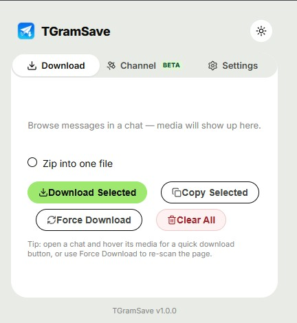
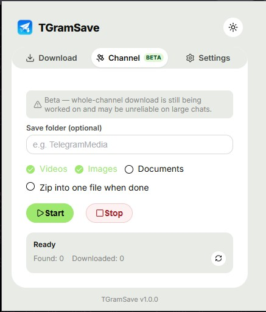
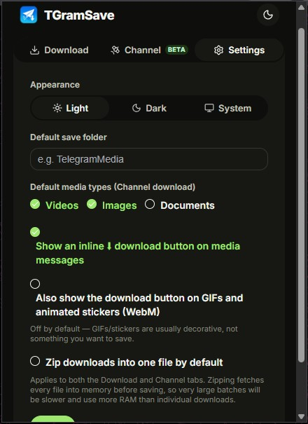

<div align="center">
  

  # TGramSave

  Browser extension for downloading media from Telegram Web. It adds download buttons under photos, videos and files on [web.telegram.org](https://web.telegram.org), and a popup for batch downloads and grabbing a whole channel.

  [](https://github.com/psnwd/TGramSave/actions/workflows/ci.yml)
  [](LICENSE)
  [](public)
  [](https://vuejs.org)
  [](CHANGELOG.md)
</div>

> Unofficial. Not affiliated with, endorsed by, or connected to Telegram FZ-LLC in any way.

## Screenshots

<div align="center">
  
  
  
</div>

## Features

**Inline download buttons.** A small download button shows up under every media message. Albums (several photos or videos in one message) get one button per item plus a "Download all" button for the group.

**Batch download popup.** Media you scroll past is collected into the popup. From there you can select some or all of it, download items one by one, zip everything into a single archive, or copy the direct links. The list keeps updating while the popup is open.

**Whole-channel download (beta).** Scrolls a chat's history and downloads every video, image and document it matches. You can cap how many of each type to take, and set an overall limit.

**Byte-correct downloads.** Files are rebuilt from range-chunked fetches with gap and size checks, instead of one plain fetch, so large videos come out complete and playable.

**GIF and sticker filtering.** Animated GIFs and stickers are skipped by default. Turn them on in Settings if you want them.

**Light, dark and system themes**, a configurable default save folder, and per-type filtering for channel downloads.

**14 UI languages.** English, Simplified/Traditional Chinese, Spanish, French, German, Portuguese (Brazil), Russian, Japanese, Korean, Italian, Turkish, Arabic and Hindi. Pick one in Settings or follow the browser language; partial translations fall back to English.

## Installation (from source)

Not on the Chrome Web Store. Load it as an unpacked extension:

```bash
git clone https://github.com/psnwd/TGramSave.git
cd TGramSave
make ext-install   # or: cd extension && bun install
make ext-build     # or: cd extension && bun run build
```

Then in Chrome, Edge or Brave:

1. Open `chrome://extensions`
2. Turn on **Developer mode** (top right)
3. Click **Load unpacked** and pick the `extension/dist/chrome` folder

Firefox (128+): `bun run build:firefox` (inside `extension/`), then open `about:debugging#/runtime/this-firefox` → **Load Temporary Add-on** and pick `extension/dist/firefox/manifest.json`.

After every rebuild, reload the extension from `chrome://extensions` and hard-refresh any open `web.telegram.org` tabs so they pick up the new content scripts.

## Development

The repo has two parts: [`extension/`](extension) (the browser extension) and [`backend/`](backend) (optional Go + SQLite server for the Premium tier, see its [README](backend/README.md)). Run extension commands from the root with the `ext-` prefix, or `cd extension` and use `bun run`.

```bash
make ext-dev        # Vite dev build, watches extension/src/ and rebuilds into extension/dist/
make ext-typecheck  # vue-tsc --noEmit only
make ext-test       # vitest run (pure helpers + catalog DOM fixtures)
make ext-build      # type-check, then production builds into extension/dist/chrome and extension/dist/firefox
make ext-package    # build, then zip into extension/dist/chrome.zip and extension/dist/firefox.zip
make ext-icons      # regenerate extension/public/icons/{16,32,48,128}.png from a master.png
make backend-run    # run the Go backend (needs KOFI_VERIFICATION_TOKEN)
make backend-test   # go vet + go test -race
make ci             # full local gate: extension lint/typecheck/test/build + backend vet/test
```

The `ext-` targets wrap the matching `bun run <script>` commands (see [extension/Makefile](extension/Makefile)), so plain `bun` or `npm` inside `extension/` works too. Load unpacked from `extension/dist/chrome`.

### Adding a language

Popup strings live in `extension/src/locales/<code>.json` (English is the source of truth and the fallback). Add the file, register it in `LOCALES` in `src/lib/i18n.ts`, and add `public/_locales/<chrome_code>/messages.json` for the manifest name/description. Missing keys fall back to English.

### Premium (optional)
Free-only by default. To enable, deploy `backend/`, then set `BACKEND_URL` and `KOFI_URL` in `extension/src/config.ts` and follow the Premium checklist in [extension/STORE_SUBMISSION.md](extension/STORE_SUBMISSION.md).

Lint and format run through [Biome](https://biomejs.dev) (config in [`biome.json`](biome.json)):

```bash
bun run check      # Biome lint + format check, no writes. This is what CI runs
bun run check:fix  # apply safe lint fixes and format
bun run format     # format only
bun run ci         # full local gate: biome ci, typecheck, build
```

CI is in [`.github/workflows/ci.yml`](.github/workflows/ci.yml). It runs `biome ci`, `vue-tsc` and a production build on every push to `main` and every pull request, then uploads the built `dist/` as an artifact. Biome lints the TypeScript. The `.vue` files are checked by `vue-tsc` instead, since Biome's template analysis isn't reliable enough to lint them cleanly.

## Marketing site

`marketing_site/` is the Next.js landing site, kept in this monorepo so the extension, backend and site version together. It is still the T3 starter page today; run it with `cd marketing_site && bun install && bun run dev`. It has its own environment file (`.env.example`) and is not required to build or use the extension.

## How it works

`extension/src/content-script/` runs in Telegram's isolated content-script world. It scans the DOM for media messages, injects the download buttons, and records what it finds in `chrome.storage` for the popup.

`extension/src/content-script-inject/` runs in the page's own MAIN world (declared with `world: "MAIN"` in the manifest). It needs same-origin access to Telegram's `blob:` and streaming URLs, which an isolated content script can't touch reliably. It does the byte-range fetching, reassembly and `<a download>` trigger.

`extension/src/channel-downloader/` is the whole-channel scroll-and-download feature.

`extension/src/background/` is the MV3 service worker. It passes messages between the content scripts and the popup, and keeps the toolbar badge count.

`extension/src/popup/` is the Vue 3 and Element Plus popup UI, with Download, Channel and Settings tabs.

## Permissions

| Permission | Why |
|---|---|
| `storage` | Recording found media, saving settings |
| `downloads`, `downloads.open` | Saving single files, ZIPs and channel runs; checking/opening finished downloads |
| `host_permissions: web.telegram.org` | The extension only runs on Telegram Web |

The popup talks to the active Telegram tab via `chrome.tabs.sendMessage`, which is covered by the host permission; no separate `activeTab` grant is needed. Chrome builds declare `minimum_chrome_version: 111` because the page-world downloader uses `world: "MAIN"` content scripts.

No `webRequest` or `declarativeNetRequest`. Downloads work by fetching with the page's own session and cookies, not by intercepting or rewriting network traffic.

## Contributing

Issues and PRs welcome. Run `bun run check`, `make ext-typecheck`, and `make ext-test` before submitting; `make ci` runs the same gate as GitHub Actions. See [CONTRIBUTING.md](CONTRIBUTING.md) and [SECURITY.md](SECURITY.md).

## Star History

<a href="https://www.star-history.com/?repos=psnwd%2FTGramSave&type=date&legend=top-left">
 <picture>
   <source media="(prefers-color-scheme: dark)" srcset="https://api.star-history.com/chart?repos=psnwd/TGramSave&type=date&theme=dark&legend=top-left&sealed_token=Fn72sZw-O4hbdyL6C4q2OZPUMaOYC3bHlAXgPgbEEBnmoOiV67T2ekKccexASEvsEsxY6kTQfWzWIwvCz90dCUaa2pmNK7sfAiuzzvrFAtg71bTVNjGdytIZUNJRHwdFqaLmFQXPKRmpxVYEN5aAJn_Lya4r2pV0WbzwXs8i5g5RK0KismslIQCWgB-x" />
   <source media="(prefers-color-scheme: light)" srcset="https://api.star-history.com/chart?repos=psnwd/TGramSave&type=date&legend=top-left&sealed_token=Fn72sZw-O4hbdyL6C4q2OZPUMaOYC3bHlAXgPgbEEBnmoOiV67T2ekKccexASEvsEsxY6kTQfWzWIwvCz90dCUaa2pmNK7sfAiuzzvrFAtg71bTVNjGdytIZUNJRHwdFqaLmFQXPKRmpxVYEN5aAJn_Lya4r2pV0WbzwXs8i5g5RK0KismslIQCWgB-x" />
   
 </picture>
</a>

## License

[Apache License 2.0](LICENSE)
